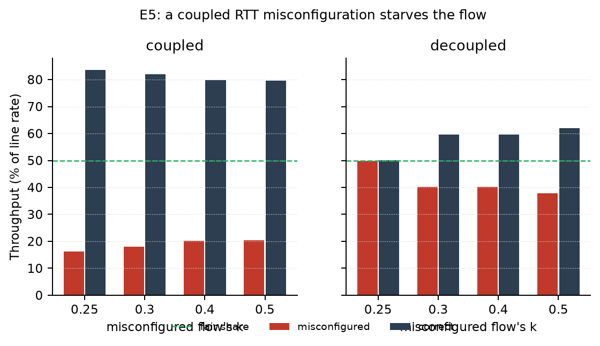

# oscar_lab：OSCAR 的“条件 O(1)”单瓶颈实验

> 目标不是复现论文全量 Evaluation，而是**隔离一个机制**：
>
> **OSCAR 的条件 O(1) 依赖“瞬态能被估计器完整观测到”（泄流$/\tau\gtrsim 2$）。** E1/E2 研究批次相位与 $Q_{\rm target}$ 对可观测性的影响；**E1 不能证伪 O(1)**（未扫 $\Delta$；且勿与论文深队列微突发的 ~25 μs 直接比）。

约 500 行 Python 事件驱动仿真，无第三方依赖（画图除外）。官方 ns-3 复现证据见 [`official_repro/`](official_repro/)；完整 ns-3 树请使用 [NASA-NJU/OSCAR](https://github.com/NASA-NJU/OSCAR)。

---

## 1. 快速开始

```bash
# 自检：单流吞吐/队列、两流公平、旧参考态基线、微突发收敛、autocal
python3 oscar_sim.py --selftest

# 核心误配实验
python3 run_experiments.py e3 --seeds 1
python3 run_experiments.py e5 --seeds 1
python3 run_experiments.py e6 --seeds 1

# 自校准与消融
python3 run_experiments.py f1 --seeds 1           # F1 autocal 开关矩阵
python3 run_experiments.py f1_ablation --seeds 1  # 消融：off/floor/D/full
python3 run_experiments.py e8 --seeds 1           # F2 物理异 RTT
python3 run_experiments.py f3 --seeds 1           # 可选 μ 烟测

# 画图（需要 matplotlib）
python3 plot_results.py
```

结果在 `results/*.csv`，图在 `figs/*.png`。完整写作见 [REPORT_OSCAR_FINAL.md](REPORT_OSCAR_FINAL.md)；简报见 [SLIDES_D7.md](SLIDES_D7.md)。

---

## 2. 文件结构

| 文件 | 内容 |
|---|---|
| `oscar_sim.py` | 单瓶颈事件驱动内核：FIFO 队列、N 条流、ACK、BLS、OSCAR 控制律、`rtt_autocal`、per-flow `prop_extra` |
| `run_experiments.py` | E1–E8 / F1 / F1 ablation / F3 跑批，输出 CSV |
| `plot_results.py` | E1–E5 + F1 / ablation / E8 图 |
| `REPORT_OSCAR_FINAL.md` | 完整研究报告 |
| `EVAL_REPRO_STATUS.md` / `EVALUATION_COVERAGE.md` | 复现状态与 Evaluation 覆盖 |
| `SLIDES_D7.md` | ~10 页 Marp slides |
| `results/` | CSV |
| `figs/` | PNG |
| `official_repro/` | 官方 ns-3 复现证据（摘要/指标/配置） |

内核的关键简化：

- 单瓶颈、固定 4 KB 包、FIFO、32 MB 缓冲（默认不丢包）；
- 每条流有 `(w, r, inflight)`，按 `r` 节奏发包，窗口封顶；
- ACK 回显 `sendTs` 和发包时的 `pktInfl`（对应 OSCAR 头部字段）；
- 估计器每 $\tau=0.5\,\mathrm{RTT}$ 解一次 BLS，样本 <3 推迟；
- 控制律：$u_w,u_r$、`max/min`、$U_{\rm AI}$、$U_{\rm HAI}$、统一 $u$。

---

## 3. 三个实验

> **审查结论（2026-11-01）**：本节最初报告“k<2/3 吞吐<1%”，经独立复现判定为 **artifact**（`bdp_floor=0` 导致窗口 <1 MTU 停等）。恢复论文 BDP 地板后是 37/48/55%，但这只是“下限按 k 重标定”的算术结果，**不构成 OSCAR 失效证据**。E3 的正确用法是研究 Algorithm 2 第 12 行的“地板 vs 上限”歧义。
>
> 下面保留的是**修正后的版本**，请连同这条警告一起读。

### E3（核心）：解耦 + 细网格——损失来自 D_target/BDP，不是估计器

**变量**：
- `coupled`：RTT 误配同时缩放 $D_{\rm target}$、BDP 下限、$\tau$、$\varepsilon$（“自然实现”的写法）；
- `decoupled`：只缩放 $\tau$、$\varepsilon$；$D_{\rm target}$/BDP 用真实单位。

**单流结果**（`figs/e3_rtt.png`，地板开）：

| $k$ | 0.50 | 0.60 | 0.62 | 0.64 | 0.655 | 0.6667 | 0.68 | 1.00 |
|---|---|---|---|---|---|---|---|---|
| coupled | 47.6 | 55.5 | 58.9 | 60.9 | 61.0 | 92.7 | 99.9 | 99.9 |
| decoupled | 99.9 | 99.9 | 99.9 | 99.9 | 99.9 | 99.9 | 99.9 | 99.9 |

**结论**：
- decoupled 全程 ~100% → **估计器（τ/ε）不是瓶颈**；
- 损失完全来自“用错误 RTT 计算 $D_{\rm target}$/BDP”；
- 转变区间约为 $(0.655, 0.68)$，中心 ≈ $2/3$（$k=0.6667$ 已到 92.7%，$k=0.68$ 才 99.9%）。

**为什么重要**：论文用 $\mathrm{RTT}_{\rm base}$ 算 $D_{\rm target}$ 和 BDP 下限；实现者自然会用同一个（可能错的）RTT。误配的后果不是“斜率估错”，而是“目标本身错了”。

---

### E5：双流竞争——误配流被饿到 16–20%

两条长流：flow0 误配 $k$，flow1 正确 $k=1$；20 ms，地板开。

| $k_0$ | coupled flow0 / flow1 | decoupled flow0 / flow1 |
|---|---|---|
| 0.25 | **16.3 / 83.7** | 49.9 / 50.0 |
| 0.30 | **18.1 / 81.9** | 40.2 / 59.8 |
| 0.40 | **20.1 / 79.8** | 40.3 / 59.7 |
| 0.50 | **20.4 / 79.6** | 37.9 / 62.1 |
| 1.00 | 50.0 / 50.0 | 50.0 / 50.0 |



**结论**：
- **coupled**：误配流只拿到 16–20%，正确流 80%，Jain 0.69–0.74——这是 **4:1 的不公平**（不是完全饿死）；
- **decoupled**：$k=0.25$ 完全公平；$k=0.3$–$0.5$ 只有 38–40% vs 60–62%（Jain 0.95–0.96），远小于 coupled；
- **归因（修正）**：伤害是**复合**的。coupled 把 $D_{\rm target}$/BDP/floor 一起缩放，损失最大；只缩放 $\tau$/$\varepsilon$（decoupled）在单流几乎无损，但在双流仍有 10–12 点不公平。没有单一旋钮能解释全部。

**机制**：误配流的 $D_{\rm target}$ 低于真实 RTT，永远处于“减速”分支，$u$ 被压到 ~0.2；正确流的 $D_{\rm target}$ 正常，占据剩余份额。窗口下限只是 cap，不保证速率。

> **审查记录**：最初版本（`bdp_floor=0`、coupled-only）报告“<1% 吞吐”，经复核判定为 artifact（窗口 <1 MTU 停等 + $k$ 未隔离）。现在的结论是解耦 + 双流之后仍然站得住的部分。

---

### E7：双流 2×2，扫 k——不公平主要来自 floor，吞吐主要来自 D_target

两流竞争，flow0 误配、flow1 正确；只切换 flow0 的 D_target / floor（τ/ε 用真值）：

| $k$ | coupled（都错） | D_target 错、floor 真 | floor 错、D_target 真 | baseline |
|---|---|---|---|---|
| 0.25 | **14.5 / 85.5** | 45.0 / 55.0 | **29.4 / 70.6** | 50 / 50 |
| 0.40 | **24.7 / 75.2** | 45.0 / 55.0 | 29.4 / 70.6 | 50 / 50 |
| 0.50 | **31.2 / 68.7** | 45.0 / 55.0 | 33.5 / 66.5 | 50 / 50 |
| 0.60 | **31.3 / 68.6** | 45.0 / 55.0 | 37.0 / 63.0 | 50 / 50 |

单流对照：floor 单独 → 99.85%，D_target 单独 → 63.2%，两者都错 → 47.9%。

**结论（测什么暴露什么，且是 k 的分解）**：
- **D_target 错单独** ≈ 45/55，**几乎与 k 无关**（Jain 0.995）——它主要造成**单流吞吐**损失（63%），不是不公平的主因；
- **floor 错单独**随 k 变强（29%→37% 份额），是**双流不公平的 k 相关主驱动**；
- 两者复合后是 14.5–31%（4:1 到 2:1）。

所以伤害是**指标依赖 + 旋钮分解**：吞吐看 D_target，公平看 floor。共同根因仍是 Algorithm 2 第 12 行“用同一个 RTT 算 BDP 下限与 D_target”。

---

### E1：批次相位 → 收敛时间

**场景**：10 条流先达到稳态（$Q=0.5$ BDP），第 5 ms 时其中 9 条离开，测第 1 条的恢复时间；扫第 1 条的批次相位偏移（0 到 $0.875\tau$）。

**结果**（`figs/e1_phase.png`）：520 μs（相位 0）→ 860 μs（相位 $0.875\tau$）。

**读法**：相位确实影响收敛（520→860 μs），说明批次相位/采样对齐是真实变量，支持做可观测性与采样对齐研究。**不要把 E1 的 520–860 μs 与论文 ~25 μs 直接对比**——后者是深队列微突发（长泄流）场景，E1 是 $Q_{\rm target}=0.5$ BDP 稳态离开场景，二者不可比。在该工作点泄流时长 $\sim\tau$，估计器难以完整捕获瞬态，恢复由 $U_{\rm HAI}=0.01$/批 主导，这是**条件 O(1) 的预期后果，不是对 O(1) 的证伪**。E1 只扫相位、没扫 $\Delta$，不能对 $T\propto\Delta^{\alpha}$ 的 scaling 下结论。**禁止主张「O(1) 已经不成立」。**

---

### E2：目标队列深度 → 收敛时间

**场景**：同 E1，但把 $Q_{\rm target}$ 从 0.25 BDP 扫到 4 BDP；离开时刻把幸存流的批次对齐到 $t_0$，去掉相位干扰。

**结果**（`figs/e2_qtarget.png`）：

| $Q_{\rm target}$ (BDP) | 0.25 | 0.5 | 1.0 | 1.5 | 2.0 | 3.0 | 4.0 |
|---|---|---|---|---|---|---|---|
| 收敛 (μs) | 660 | 480 | 420 | 690 | **100** | **90** | 420 |

**读法**：论文默认的 0.5 BDP 是 480 μs；到 2–3 BDP 才降到 ~100 μs。**要让一个批次完整落在泄流段里，泄流至少要持续 $2\tau={\rm RTT}$，即 $Q\gtrsim1$–$2$ BDP。** 4 BDP 又变慢，说明队列太深会触发过砍（over-cut），存在一个“可观测性甜点”，不是越深越好。

> E2 非单调，1.5 BDP 处有异常；原因是离开前的包还混在第一批 ACK 里（前序污染）。这本身是一个可继续做的点：如何只用“离开后发出的包”做估计。

---

## 4. 可宣称的结论

1. **E1 不证伪 O(1)**：条件 O(1) 要求泄流$/\tau\gtrsim 2$（且 $\mathrm{RTT}/$泄流 $\lesssim 1$）。在 $Q_{\rm target}=0.5$ BDP 离开场景下泄流 $\sim\tau$，HAI 主导恢复（~0.5–0.9 ms）与该条件一致，不是反例。E1 的实义是**批次相位影响恢复时间**，支持可观测性/采样对齐研究。
2. **论文 ~25 μs 与 E1 的 520–860 μs 不可直接比**：前者是深队列微突发（队列可至 ~10 BDP、泄流 ~10 RTT，$|g|\approx1$ 可一步到位），后者是浅队列稳态离开；把二者当证据比较是苹果对橘子。要对 O(1) 的 scaling 下结论须扫 $\Delta$、拟合 $T\propto\Delta^{\alpha}$——E1/E2 **没有扫 $\Delta$**。
3. **RTT 误配的伤害是“测什么暴露什么”**：单流吞吐损失主要来自 D_target（63%，floor 单独 99.85%）；双流不公平主要来自 floor（33.5/66.5，D_target 单独 45/55 几乎公平）。τ/ε 的估计误差在单流几乎无害，在双流只有 10 点左右的次级影响。共同根因是 Algorithm 2 第 12 行“用同一个 RTT 算 BDP 下限与 D_target”。
4. **在线 min-RTT 自校准（F1）可显著拉回**单流吞吐（47%→99%）与双流公平（16/84→45/55，Jain 0.69→0.99），前提是**连 τ/ε 一起校准**（`autocal_est`）；物理异 RTT（F2）下生产式 min 标定会饿长流，autocal 可缓和。

---

## 5. 已知局限

- **单瓶颈**：多瓶颈下 $g$ 是各跳之和，结论不直接适用。
- **确定性**：没有随机丢包/到达抖动，同一配置重复跑结果相同；误差棒要靠在参数上扫，而不是靠种子。
- **简化基线**：HPCC 式基线只用于定性对照（过冲/振荡），不是 HPCC 的忠实实现。
- **无 PFC/ECN**：缓冲区默认 32 MB 不丢包；PFC 场景未覆盖。
- **E2 的前序污染**：离开前发出的包仍在第一批 ACK 里，导致非单调；需要“只统计离开后发出的包”的变体。
- **E1/E2 仍未在论文地板上重跑**：它们用 `bdp_floor=0`，结论只能当 hypothesis；E5 只有 2 条流、1 个种子，是机制性证据，不是统计性证据。
- **E5 的工作点是论文目标的 2 倍**：`bdp_floor=1.0` 是“每流 1 BDP”，两流合计 2 BDP，稳态队列 ~1 BDP；不要把它和论文 0.5 BDP 的数字直接比。
- **E4 未完成**：AI 归一化（$U_{\rm AI}/\hat n$）的代码路径在，但 n=100 时的稳态吞吐异常（~0.2%），不要直接用。
- **F1 不是“完全公平”**：E5 coupled +autocal 份额 44.8/55.2（非 50/50）；但必须开 `autocal_est`，否则只校 D_target/floor 会停在 ~34/66。
- **Autocal 实现细节**：采用 running min-RTT（只降不升）；纯批内 $d_{\min}$ 会在深队列下抬高 $D_{\mathrm{target}}$——报告须写明。
- **无 ns-3**：本目录结果仅为事件驱动单瓶颈；生产部署主张需另验（见 `official_repro/` 与上游仓库）。

---

## 6. 可调参数

| 改动 | 目的 |
|---|---|
| `Config.rtt_autocal` / `autocal_d` / `autocal_floor` | F1 自校准与消融 |
| `Config.flow_prop_extra` / `hetero_calib` | F2 物理异 RTT |
| `Config.duration` / `mtu` | 控制事件规模；4 KB、10–15 ms 是甜点 |
| `Config.bdp_floor` | 打开论文伪代码里的 `max(..., BDP)` 下限 |
| `oscar_sim.py::_on_depart` | “只统计 $t_0$ 之后发出的包”变体（E2 前序污染） |

---

## 7. 与主报告的关系

终稿报告见 [REPORT_OSCAR_FINAL.md](REPORT_OSCAR_FINAL.md)：论文机制、Evaluation 地图、官方/简化证据分层与扩展结论均在其中。本 README 给可复现实验入口与机制解读。
